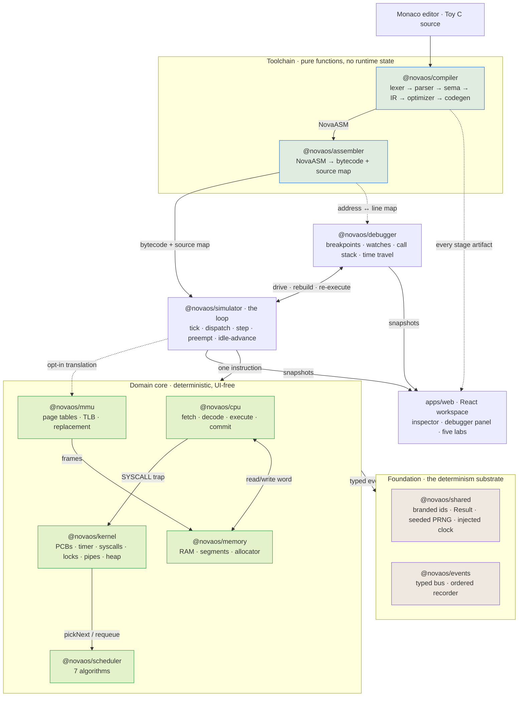

# NovaOS

**A browser-based operating-systems lab: a C-like compiler, a 32-bit VM, a preemptive
kernel, virtual memory, and a deterministic time-travel debugger — 22k lines of
strict TypeScript with a zero-dependency simulation core.**

[**▶ Try it live**](https://nova-os-lab.vercel.app/) · no install, no sign-in

[](https://github.com/YheChen/NovaOS/actions/workflows/ci.yml)
[](#testing)
[](LICENSE)

You write a program in a small C dialect. NovaOS lexes it, parses it, type-checks it,
lowers it to an SSA-free IR in basic blocks, optimizes it, emits assembly for an
instruction set I designed, assembles that to bytecode, loads it into a simulated
64 KB address space, and executes it one instruction at a time on a kernel that
schedules it, faults it, and answers its syscalls. Then you step **backwards**
through the whole thing.

Nothing is mocked and nothing is `eval`'d. Every layer is a real implementation
with a test suite, and the entire engine is deterministic by construction — which
is what makes reverse debugging, byte-identical golden tests, and _reproducible_
data races possible.

---

## The path a program actually takes

```
main.c
  │
  ├─ lexer ──────►  tokens                     32 tokens
  ├─ parser ─────►  AST                        recursive descent + error recovery
  ├─ semantics ──►  typed symbol table         int / bool, arity, scope, returns
  ├─ ir-gen ─────►  NovaIR (basic blocks)      13 instructions
  ├─ optimizer ──►  NovaIR (optimized)         9 instructions, 3 passes
  ├─ codegen ────►  NovaASM                    35 lines, stack-based frames
  └─ assembler ──►  bytecode                   28 instructions / 112 bytes
                          │
                          ▼
        ┌───────────────────────────────────────────────────────────┐
        │  NovaVM  —  32-bit machine                                │
        │                                                           │
        │    CPU      fetch → decode → execute → commit             │
        │    kernel   PCBs · quantum timer · syscall trap · faults  │
        │    memory   segments · first-fit heap · optional MMU      │
        └───────────────────────────────────────────────────────────┘
                          │  every state transition is a typed event
                          ▼
        debugger  —  breakpoints · watches · call stack · step backward
```

The numbers above are the real output of `compileToyC` on the seven-line program the
[live demo](https://nova-os-lab.vercel.app/) opens with. It executes in 28
instructions and emits 103 events. `fib(10)` takes 6,469 instructions and emits
19,311 events across 19 distinct event types — all of them replayable.

## What is actually implemented

| Subsystem           | Implementation                                                                                                                                                | Where                                                                                                  |
| ------------------- | ------------------------------------------------------------------------------------------------------------------------------------------------------------- | ------------------------------------------------------------------------------------------------------ |
| **Instruction set** | 37 opcodes, fixed 32-bit `[OP·A·B·C]` words, little-endian; PC-relative 16-bit branches; 8 GPRs + `pc`/`sp`/`bp`/`ir` + 6 flags                               | [`packages/cpu`](packages/cpu/src/opcodes.ts)                                                          |
| **Compiler**        | Toy C → tokens → AST → typed IR → 3 optimization passes → NovaASM, with full source maps                                                                      | [`packages/compiler`](packages/compiler/src)                                                           |
| **Assembler**       | NovaASM → bytecode: labels, `.global`, two-pass relocation, address↔line map                                                                                  | [`packages/assembler`](packages/assembler/src)                                                         |
| **Kernel**          | Boot stages, PCBs, 8-state process lifecycle with a transition table, quantum-timer preemption, context switch, fault model, 11 syscalls                      | [`packages/kernel`](packages/kernel/src/kernel.ts)                                                     |
| **Schedulers**      | FIFO, Round-Robin, Priority, Lottery, SJF, SRTF, MLFQ + a metrics/Gantt comparison harness                                                                    | [`packages/scheduler`](packages/scheduler/src)                                                         |
| **Memory**          | 64 KB byte-addressable RAM, first-fit segment allocator, per-process code/data/heap/stack, coalescing `malloc`/`free`                                         | [`packages/memory`](packages/memory/src), [`heap.ts`](packages/kernel/src/heap.ts)                     |
| **Virtual memory**  | Page tables, VA decode, demand paging, FIFO + Clock replacement, LRU TLB, per-process address spaces                                                          | [`packages/mmu`](packages/mmu/src)                                                                     |
| **Concurrency**     | Kernel mutexes with FIFO wait queues and direct hand-off; shared memory; a real two-process data race that a lock provably fixes                              | [`packages/kernel`](packages/kernel/src/kernel.ts), [`packages/concurrency`](packages/concurrency/src) |
| **IPC**             | Message-passing pipes; a `send` to a blocked receiver writes straight into its `R0` and wakes it                                                              | [`ipc.test.ts`](packages/simulator/src/ipc.test.ts)                                                    |
| **Filesystem**      | Inode VFS, path resolver, permissions, snapshot/restore, versioned persistence envelope → IndexedDB                                                           | [`packages/filesystem`](packages/filesystem/src)                                                       |
| **Debugger**        | 5 breakpoint kinds, eval-free watch expressions, call-stack reconstruction, timeline scrubber, step backward                                                  | [`packages/debugger`](packages/debugger/src/controller.ts)                                             |
| **Shell**           | 21 builtins (`ls`, `cat`, `compile`, `run`, `ps`, `kill`, `mem`, `cpu`, …) over the VFS and live kernel state — library-level; not yet surfaced in the web UI | [`packages/shell`](packages/shell/src/builtins.ts)                                                     |

## Architecture



Read it as three flows: **down the left**, source becomes bytecode and then
instructions; **across the middle**, one instruction touches the CPU, the kernel,
and memory; **out to the right**, every state transition leaves as a typed event or
a serializable snapshot. The debugger is the only component that both drives the
runtime _and_ rebuilds it — that double arrow is where time travel lives.

Three invariants hold the system together, and all three are **mechanically
enforced** by [`scripts/check-architecture.ts`](scripts/check-architecture.ts)
in CI (212 source files scanned on every push):

1. **The dependency graph points downward and is acyclic.** Every package exposes
   its API through a single `src/index.ts`; deep imports into another package's
   internals fail the build, as does any `@novaos/*` import not declared in that
   package's `package.json`.
2. **The domain core is UI-free.** No React, DOM, Monaco, or Zustand below the
   presentation layer; `@novaos/ui` imports no domain package. The UI owns no
   simulation state — it renders serializable snapshots and typed events.
3. **The domain core is deterministic.** `Math.random()` and `Date.now()` are
   rejected in all 15 deterministic packages, and `eval` / `new Function` are
   rejected everywhere in the repo. Randomness comes from a seeded PRNG and time
   from an injected `SimulationClock`.

Rule 3 is not a style preference — it is the load-bearing decision. Reverse
debugging, golden tests, and reproducible races all reduce to "the same inputs
produce the same trace."

## The compiler

`compileToyC` is a straight pipeline that returns _every_ intermediate artifact so
the UI can show the program being lowered stage by stage
([`compile.ts`](packages/compiler/src/compile.ts)):

- **Lexer** — tokens with source spans; comments preserved separately.
- **Parser** — hand-written recursive descent with precedence climbing and panic-mode
  error recovery: on a bad statement it `synchronize()`s to the next statement
  boundary and keeps parsing, so one typo yields one diagnostic instead of a cascade.
  A progress guard (`if (current === before) advance()`) makes non-termination on
  malformed input structurally impossible.
- **Semantic analysis** — scoped symbol table, `int`/`bool` type rules, call arity
  and return-path checks. Errors are `Diagnostic` values, never exceptions.
- **IR generation** — `NovaIR`: functions → basic blocks → instructions plus an
  explicit terminator (`return` / `jump` / `branch`). Control flow is normalized
  here, so `if`, `while`, `do/while`, `for`, `break`, and `continue` all collapse to
  the same three terminators, and the UI can render a real CFG.
- **Optimizer** — constant folding (with exact 32-bit wrapping semantics via
  `Math.imul` and `>>>`), copy propagation, and dead-code elimination, each
  reporting a change count. Every pass is individually toggleable in the browser,
  so you can watch the IR shrink: the demo program goes 13 → 9 instructions.
- **Codegen** — stack-machine lowering to NovaASM with a source span recorded for
  every emitted line. The calling convention
  ([ADR-0004](docs/adr/0004-isa-extension-and-calling-convention-for-toy-c.md)) is
  explicit: `PUSH BP; MOVR BP, SP` prologue, arguments pushed right-to-left and read
  by the callee at `[BP + 8 + 4i]`, locals and temporaries at `[BP - 4(slot+1)]`,
  `MOVR SP, BP; POP BP; RET` epilogue — all of it pinned by a golden test.
- **Assembler** — two passes (assign addresses and collect symbols, then encode and
  relocate), producing bytecode plus an address↔assembly-line map. Joining that with
  codegen's line spans yields the Toy C source map the debugger and editor gutter
  both consume. An unknown mnemonic gets a Levenshtein-based "did you mean"
  suggestion rather than a bare error.

The language is small but honest about it: `int` and `bool`, functions with
recursion, full operator precedence including `& | ^ << >>`, `if`/`else`, `while`,
`do/while`, `for`, `break`/`continue`, compound assignment, short-circuit `&&`/`||`,
fixed-size arrays, and `malloc`/`free`/`peek`/`poke`. There are no globals,
pointers, structs, or strings.

```c
int fib(int n) {
  if (n < 2) { return n; }
  return fib(n - 1) + fib(n - 2);
}

int main() {
  print(fib(10));   // 55
  return 0;
}
```

## The VM and runtime

**Instruction format.** One fixed 32-bit word: `[ OPCODE(8) | A(8) | B(8) | C(8) ]`,
`(op<<24)|(a<<16)|(b<<8)|c`, stored little-endian. Branch targets are PC-relative
16-bit offsets packed into `B`/`C`, which keeps code position-independent no matter
where the loader places the segment. `LOAD`/`STORE` take a signed byte displacement
in `C` — cheap to decode, and the direct cause of one of the project's real
limitations (see below).

**Execution.** `cpu.step()` is one honest cycle: fetch the word at `pc`, decode it,
dispatch to a pure handler that returns an _effect_ (`registerWrites`,
`memoryWrites`, `flags`, `output`, `nextPc`), then commit that effect and publish an
event for each observable change. Handlers never touch mutable state, which is why
they are trivially testable and why the trace is exact — a register event is emitted
only when the value genuinely changes.

**Traps.** `HALT` short-circuits before execution. `SYSCALL` calls out through a
`SyscallTrap` the kernel installs, and the outcome drives the CPU's status:
`return` continues, `exit` halts, and `block`/`yield` return `blocked` so the
runtime can deschedule the process _after_ `pc` has already advanced — that ordering
is what makes a blocking syscall resume on the next instruction instead of
re-executing itself.

**The loop.** [`runtime.ts`](packages/simulator/src/runtime.ts) owns the clock and
the mechanism; the kernel owns policy. Each step wakes due sleepers, dispatches if
nothing is running, executes one instruction, advances the clock by the retired
cycles, and then either terminates, faults, commits a deschedule, or fires the
timer interrupt. When every process is asleep, the loop _idle-advances the clock_ to
the earliest wake tick instead of spinning — simulated time, not wall-clock time.

Measured on an Apple M4 (Node 25, single-threaded, event recording on): a 600,035
instruction run completes in ≈350 ms, ≈1.7M instructions/second.

## The kernel

- **Processes.** A PCB per process carrying registers, its four segments,
  scheduling metadata, and accounting (instructions, CPU ticks, syscalls, context
  switches). The lifecycle has 8 states (`new`, `ready`, `running`, `waiting`,
  `blocked`, `sleeping`, `terminated`, `faulted`) governed by a legal-transition
  table that the kernel is the sole authority over, so an illegal transition is a
  caught bug rather than corrupted state.
- **Preemption.** `dispatch` seeds `quantumRemaining` from the scheduler's
  `quantumTicks`; `recordInstruction` decrements it by retired cycles;
  `shouldPreempt` reports expiry; `handleTimerInterrupt` captures registers,
  requeues the process, and dispatches the next. Context switching goes through a
  narrow `RegisterPort` (`capture`/`load`), which is the only coupling between the
  kernel and the CPU's register file.
- **Syscalls.** 11 of them — `print`, `malloc`, `free`, `exit`, `sleep`, `yield`,
  `lock`, `unlock`, `shared`, `send`, `receive` — each a pure function from a
  request context to an outcome (`return` / `exit` / `sleep` / `yield` /
  `block-on-channel`). The kernel translates outcomes into state transitions; the
  handlers themselves cannot corrupt anything.
- **Memory.** A first-fit segment allocator hands each process code, data, heap, and
  stack out of the 64 KB physical space, with a fragmentation summary for the
  visualizer. `malloc`/`free` run a first-fit heap _inside_ the process's heap
  segment, coalescing adjacent free spans on release.
- **Blocking and wakeups.** Sleeping processes are held in a `pid → wake tick` map
  that the runtime scans for the earliest deadline.
  Mutexes are keyed by id with per-channel FIFO wait queues, and `unlock` hands the
  lock **directly** to the next waiter rather than re-opening the race; terminating a
  process releases the locks it held, so a buggy `exit` cannot deadlock the system.
  Pipes reuse the same wait-channel machinery under a channel-id offset so pipe and
  mutex channels can never collide.
- **Faults.** Six VM fault codes (invalid opcode, invalid operand, segmentation
  fault, divide by zero, stack overflow/underflow) plus kernel faults. A faulting
  process transitions to `faulted` with its registers preserved for inspection.

### Scheduling, measured

Seven algorithms share one `Scheduler` interface (`enqueue`, `remove`, `pickNext`,
`requeue`, `quantumTicks`, `snapshot`/`restore`) and never mutate process state —
the kernel admits ready processes and the scheduler only chooses ordering. The
comparison harness runs one workload through all seven on the same deterministic
clock. On the built-in "convoy effect" workload — four jobs with bursts 8/2/1/2,
all arriving within two ticks:

| Algorithm                     | Avg turnaround | Avg waiting | Avg response | Ctx switches |
| ----------------------------- | -------------- | ----------- | ------------ | ------------ |
| First Come First Served       | 9.50           | 6.25        | 6.25         | 4            |
| Round Robin (q=4)             | 7.75           | 4.50        | 3.25         | 5            |
| Priority                      | 9.50           | 6.25        | 6.25         | 4            |
| Lottery (seeded)              | 7.50           | 4.25        | 3.00         | 5            |
| Shortest Job First            | 9.25           | 6.00        | 6.00         | 4            |
| Shortest Remaining Time First | **5.25**       | **2.00**    | **0.75**     | 5            |
| Multi-Level Feedback Queue    | 7.75           | 4.50        | 3.25         | 5            |

One long job at the head of the queue costs FCFS 4.25 ticks of average turnaround
versus preemptive SRTF — the convoy effect, reproduced rather than described. Lottery
is seeded, so even the randomized policy lands on the same number every run.

Adding SRTF and MLFQ required **zero** changes to the kernel: SRTF is a
`quantumTicks = 1` policy that re-picks every tick, and MLFQ exposes
`quantumTicks` as a getter that returns the current level's quantum. The kernel
reads that value right after `pickNext`, so per-level quanta fall out of the
existing mechanism.

### Virtual memory

[`@novaos/mmu`](packages/mmu/src) is a standalone MMU: configurable page geometry,
VA decode into VPN + offset, per-process page tables with permission and
dirty/referenced bits, a physical frame table, demand paging with FIFO or Clock
(second-chance) replacement, and an LRU TLB. Every translation returns a
step-by-step trace, which is exactly what the Paging lab renders.

The runtime can route the CPU's entire memory port through it
([`paging.ts`](packages/simulator/src/paging.ts)). In `identity` mode everything is
pre-mapped; in `demand` mode each PID gets its own resident set, pages fault in on
first touch, and the TLB is flushed on address-space switch. Running `fib(10)`
through the demand pager: 10,808 translations, 10,802 TLB hits, 6 page faults,
identical output and identical instruction count to the untranslated run.

### Concurrency and IPC, with reproducible races

Two processes increment one shared word under a round-robin scheduler with
`quantum = 1`. Without a lock the interleaved read-modify-write **loses updates**
every time; wrap the critical section in `lock`/`unlock` and the count is exactly
right — asserted as a test, not a demo
([`concurrency.test.ts`](packages/simulator/src/concurrency.test.ts)):

```
2 processes × 8 increments, no lock  →  counter < 16   (updates lost)
2 processes × 8 increments, mutex    →  counter = 16   (exact)
```

The standalone [race demonstration](packages/concurrency/src/race-demo.ts) makes the
same point at micro-step granularity: 4 threads × 25 increments with seed 42 loses
**64 of 100** increments, and the identical 300-step interleaving is reproduced
byte-for-byte on every run. A race you can replay is a race you can actually study.

Producer/consumer over a pipe works the same way: the consumer blocks on the empty
pipe, and the producer's `send` writes the value into the blocked receiver's `R0`
and wakes it.

## Time-travel debugging

This is the part worth reading the source for, including how it is built — because
the mechanism is a deliberate trade, not magic.

**What is recorded.** Nothing is snapshotted. The debugger records only the _cursor_:
which step number you are at. Everything else is derived.

**How determinism is achieved.** Domain packages cannot call `Math.random()` or
`Date.now()` (CI rejects them), so a program's execution is a pure function of
`(bytecode, scheduler, seed)`. The event bus assigns monotonically increasing
sequence numbers on publish, so the _trace_ is a total order, not just a set.

**How stepping backward works.** `stepBack()` and the timeline scrubber call
`seekToStep(n)`, which **rebuilds the runtime from scratch and re-executes exactly
`n` instructions** ([`controller.ts`](packages/debugger/src/controller.ts)). Because
execution is deterministic, the reconstructed state at step `n` is bit-identical to
the original — registers, memory, stack, heap, process table, and output all agree.
Rewinding is therefore _correct by construction_ rather than correct if the
snapshot/undo log happened to capture everything.

**The trade.** Reverse stepping is O(n) in the step index, not O(1). Rewinding one
instruction at step 2,000 of `fib(10)` costs ≈1.6 ms — imperceptible, and the
`fib(10)` timeline tops out at 6,469 steps. But the cost grows linearly, so a
million-instruction program would rewind slowly. Periodic snapshot checkpointing
(seek to the nearest checkpoint, then replay the remainder) is the standard fix and
is not implemented; the current design buys correctness and roughly 20 lines of
state management instead.

**What else the debugger reconstructs.** The call stack is walked from the live
saved-`BP` chain in stack memory, cross-referenced against assembler symbols to name
each frame and against the source map to resolve each frame's line. Five breakpoint
kinds are supported — line, instruction address, conditional, exception, and memory
write. Watch expressions and breakpoint conditions run through a
[hand-written recursive-descent evaluator](packages/debugger/src/watch.ts) with its
own grammar (`R0`, `mem[SP]`, `BP - SP`, comparisons) precisely so that user input
never reaches host `eval` — which the architecture check enforces repo-wide.

**Limitations, stated plainly.** A debug session runs a single process under FIFO
scheduling, so you cannot currently reverse-step a preempted multi-process
interleaving through the UI. Sizing the timeline scrubber calls `getTotalSteps()`,
which runs the program to completion once. `continue`/`step` skip breakpoints on the
line they are parked on until execution leaves that line region, so a breakpoint
inside a loop re-arms correctly.

## The web workspace

[`apps/web`](apps/web) is a Vite + React SPA built entirely on the domain packages —
it renders real snapshots and real events, never fixtures. Six views:

| View                 | What it does                                                                                                                                                                                                                                                                                             |
| -------------------- | -------------------------------------------------------------------------------------------------------------------------------------------------------------------------------------------------------------------------------------------------------------------------------------------------------- |
| **Workspace**        | Monaco editor, the compiler inspector (Diagnostics · Tokens · IR · Optimized IR · Optimizer · CFG · Assembly · Bytecode · Symbols), and the live debugger: registers with changed-value highlighting, call stack, annotated stack memory, heap blocks, process table, watches, and the timeline scrubber |
| **Scheduler Lab**    | One workload through all seven algorithms; metrics table plus an SVG Gantt chart on a shared time axis                                                                                                                                                                                                   |
| **Paging**           | Translate an address and watch the page-table walk, frame allocation, TLB, and eviction step by step                                                                                                                                                                                                     |
| **Concurrency Lab**  | Watch a data race lose updates, add a lock, watch it become correct — deterministically                                                                                                                                                                                                                  |
| **Files**            | A virtual filesystem that survives a page reload via IndexedDB                                                                                                                                                                                                                                           |
| **Guided Tutorials** | Five checkpointed lessons whose assertions are verified against the real engine                                                                                                                                                                                                                          |

Programs autosave to `localStorage`, and **Share** encodes the current source into
the URL fragment for a permalink.

<!-- Screencast: record docs/media/demo.gif per docs/demo.md, then uncomment.
<p align="center"></p>
-->

**60-second tour** — [open the workspace](https://nova-os-lab.vercel.app/) and:

1. Press **Compile**, then click through the inspector tabs to watch `main.c` become
   tokens, IR, optimized IR, a CFG, assembly, and finally bytecode.
2. Toggle the optimizer passes and watch the IR instruction count drop from 13 to 9.
3. Press **Run** — the output panel prints `15`, exit `0`.
4. Press **Debug**, then **Step into** twice. Execution pauses on line 3; `R0` lights
   up as changed, the call stack shows `main ← _start`, and the stack view labels the
   saved `BP` and return address it just pushed.
5. Press **Step back**. `PC` goes 1128 → 1124, the highlighted line returns to 2, and
   the timeline reads `step 8 / 28`. Drag the scrubber to scan the whole run.
6. Load the **Recursion (Fibonacci)** example and debug it to watch the call stack
   grow and unwind.

## Testing

**414 unit and integration tests across 63 files, plus 12 Playwright end-to-end
tests** against the built SPA. Every tier below runs in CI on every push and pull
request.

| Tier            | What it proves                                                                                                                                                                                                                                                                                                                                                                                        | Command                 |
| --------------- | ----------------------------------------------------------------------------------------------------------------------------------------------------------------------------------------------------------------------------------------------------------------------------------------------------------------------------------------------------------------------------------------------------- | ----------------------- |
| Unit            | Per-package behavior — decoder, handlers, allocator, page tables, replacement, TLB, schedulers, mutexes, parser, heap, VFS                                                                                                                                                                                                                                                                            | `pnpm test`             |
| Property / fuzz | 4 seeded-random suites, each asserting an invariant rather than an output: the allocator never returns overlapping or out-of-bounds segments over 800 random reserve/release ops; `canonicalize` is idempotent and can never escape the root; the parser never throws on random token soup; MMU translation stays consistent under random access sequences. Seeded, so any failure reproduces exactly | included in `pnpm test` |
| Integration     | Cross-package flows through public APIs only — compiler → VM prints `15`; a line breakpoint resolved through the source map pauses on the right line; filesystem → shell → terminal                                                                                                                                                                                                                   | `pnpm test:integration` |
| Golden          | Byte-exact toolchain output: a known NovaASM program must encode to exact little-endian bytes; identical source must produce identical bytecode; the calling-convention prologue/epilogue and IR shape are pinned                                                                                                                                                                                     | `pnpm test:golden`      |
| Replay          | The determinism guarantee itself: two independent runs must agree on output, event count, _and_ the ordered event-type sequence; sequence numbers must be strictly monotonic                                                                                                                                                                                                                          | `pnpm test:replay`      |
| Architecture    | The three invariants above, statically, over 212 source files                                                                                                                                                                                                                                                                                                                                         | `pnpm check:arch`       |
| End-to-end      | The real SPA in Chromium: compile-and-run prints `15`, the inspector shows stages, a debug session starts paused at entry, the race reproduces, the Gantt renders, an address translates, IndexedDB survives a reload, tutorial checkpoints verify. 2 tests are keyboard-accessibility assertions                                                                                                     | `pnpm test:e2e`         |

The tutorial checkpoints double as a cross-subsystem oracle: they assert on real
compiler diagnostics, real program output, and real MMU translations, so a
regression anywhere in the toolchain turns the tutorials red.

```bash
pnpm validate   # format:check · lint · typecheck · test · build · check:arch
```

## Engineering decisions and trade-offs

**Determinism as an architectural constraint, not a convention.** Banning
`Math.random()`/`Date.now()` in the domain core is enforced by a static check, not a
code-review habit. That one rule is what makes reverse debugging trivially correct,
golden tests possible, and data races reproducible. The cost is that every source of
nondeterminism must be injected — the clock, the PRNG, and the whole notion of
"now" — which is more ceremony everywhere in exchange for one very large property.

**Time travel by re-execution rather than by snapshots.** Re-running from step 0 is
O(n) per rewind, but it cannot drift: there is no undo log to get subtly wrong, and
no risk of a newly added piece of state being forgotten by the snapshot code.
Given that a typical program here is thousands of instructions, correctness was the
better buy. Checkpointing is the known escape hatch if programs get longer.

**Pure instruction handlers returning effects.** Handlers take
`(instruction, registers, memory)` and return a description of what should change;
the CPU commits it. This makes every instruction unit-testable without a machine,
makes the event stream exact (an event fires only on a real change), and keeps the
write-back path in exactly one place.

**Kernel owns policy; the runtime owns the loop.** The kernel never advances the
clock or drives execution — it decides _what should happen_. This split
([ADR-0003](docs/adr/0003-kernel-runtime-responsibilities.md)) is why the same
kernel serves the debugger, the headless test runtime, and the browser without
modification. It also produced the project's sharpest constraint: SRTF and MLFQ were
implemented purely as scheduler policy (a `quantum = 1` and a dynamic
`quantumTicks` getter) with **zero** changes to the kernel's preemption path.
When a scheduling algorithm seems to need a new kernel hook, that is a signal the
mechanism is wrong.

**A hand-written expression evaluator instead of `eval`.** Watch expressions and
conditional breakpoints are user input. A ~180-line recursive-descent evaluator with
an explicit grammar means the sandbox property is structural, and `no-eval` can be
enforced repo-wide for free.

**Snapshots as the UI's only diet.** The UI subscribes to serializable snapshots and
typed events and owns no simulation state. Consequence: the entire engine runs
headless in Node under Vitest, and the React layer is thin enough that all six views
are plain rendering code.

**A signed-byte `LOAD`/`STORE` displacement.** Simple, uniform, fast to decode —
and it caps a stack frame at 32 slots, because `-4 × 32 = -128` is the limit of a
signed byte. Since codegen does not reuse temporary slots, a function with a large
array plus many temporaries hits the cap and gets a clear
`codegen/frame-too-large` diagnostic instead of silent corruption. A real ISA
constraint producing a real compiler error is, pedagogically, a feature; fixing it
properly means slot reuse or a wider displacement encoding.

## Known limitations

Stated so you don't have to go looking for them:

- **No address-space isolation.** Demand paging is real, but frames are
  identity-mapped and the kernel assigns physical `pc`/`sp`. True isolation needs
  non-identity relocation, virtual `pc`/`sp`, and a backing store.
- **Reverse stepping is O(n)** in the step index (no snapshot checkpointing), and
  debug sessions are single-process under FIFO.
- **Toy C has no globals, pointers, structs, or strings**, and `else if` is nested
  `if`/`else` rather than sugar.
- **Codegen has no register allocation** — it is a stack machine with a 32-slot
  frame cap. The optimizer's win is therefore visible in the IR, not in register
  pressure.
- **The shell and terminal are not wired into the web UI.** They are complete,
  tested libraries driven by acceptance tests against a live kernel; the browser
  workspace does not yet expose a terminal.
- **`getTotalSteps()` runs the program to completion** to size the timeline
  scrubber.

## Getting started

Requires Node `>= 20` and [pnpm](https://pnpm.io/).

```bash
git clone https://github.com/YheChen/NovaOS.git
cd NovaOS
pnpm install
pnpm validate                        # the full gate: format, lint, types, tests, build, arch
pnpm --filter @novaos/web dev        # workspace at http://localhost:3000
```

Useful single commands:

```bash
pnpm exec vitest run packages/compiler   # one package's tests
pnpm test:replay                         # the determinism guarantee
pnpm check:arch                          # the three architecture invariants
pnpm test:e2e                            # Playwright against the built SPA
```

## Repository layout

18 implemented workspace packages plus one app, strict TypeScript throughout
(`noUncheckedIndexedAccess`, `verbatimModuleSyntax`, branded ids, discriminated
unions), zero runtime dependencies in the domain core.

```
packages/
  shared        branded ids · Result · seeded PRNG · injected clock · diagnostics
  events        typed event bus + ordered recorder
  cpu           ISA · register file · decoder · pure handlers · syscall trap
  memory        byte-addressable RAM · segments · first-fit allocator
  kernel        boot · PCBs · timer · syscalls · heap · locks · pipes
  scheduler     7 algorithms + workload comparison harness
  mmu           page tables · demand paging · FIFO/Clock · TLB
  concurrency   mutex · semaphore · replayable race demonstration
  filesystem    inode VFS · path resolver · permissions · persistence
  shell         21 builtins over the VFS and live kernel state
  terminal      session runtime
  assembler     NovaASM → bytecode + source map
  compiler      Toy C: lexer → parser → sema → IR → optimizer → codegen
  debugger      breakpoints · watches · call stack · time-travel replay
  simulator     wires the machine together; ticking · snapshots · paging
  examples      curated, tested programs
  tutorials     checkpointed lessons verified against the engine
  testing       shared event/test helpers
apps/web        Vite + React workspace SPA
```

(`packages/ui` is an unused scaffold from an earlier plan — the workspace's
components live in `apps/web` instead.)

## Documentation

- [`docs/specs/`](docs/specs) — subsystem specifications
- [`docs/adr/`](docs/adr) — architecture decision records (ISA and calling
  convention, event shape, kernel/runtime split, UI stack)
- [`docs/demo.md`](docs/demo.md) — a 30-second guided tour
- [`docs/contributing.md`](docs/contributing.md) — contribution guide

## License

[MIT](LICENSE).
